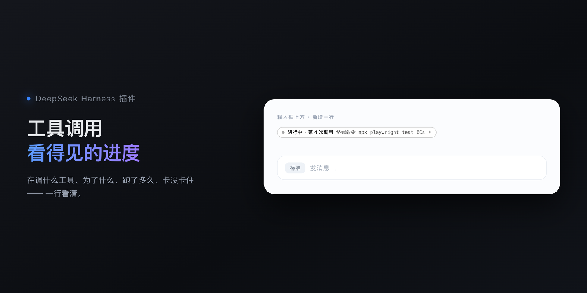
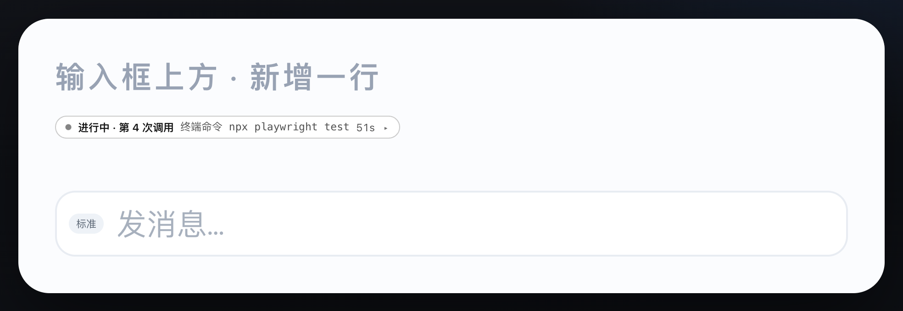
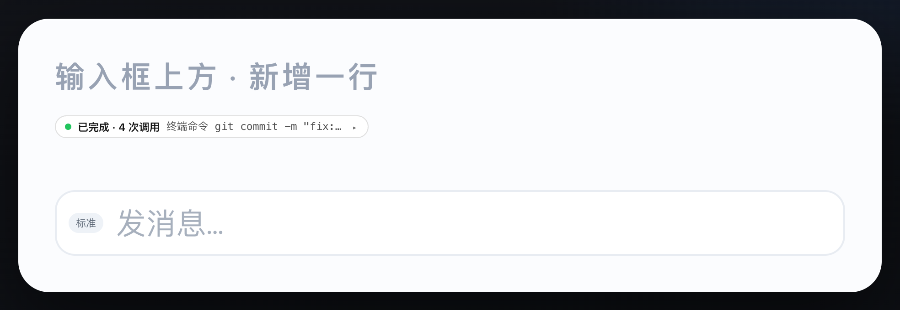
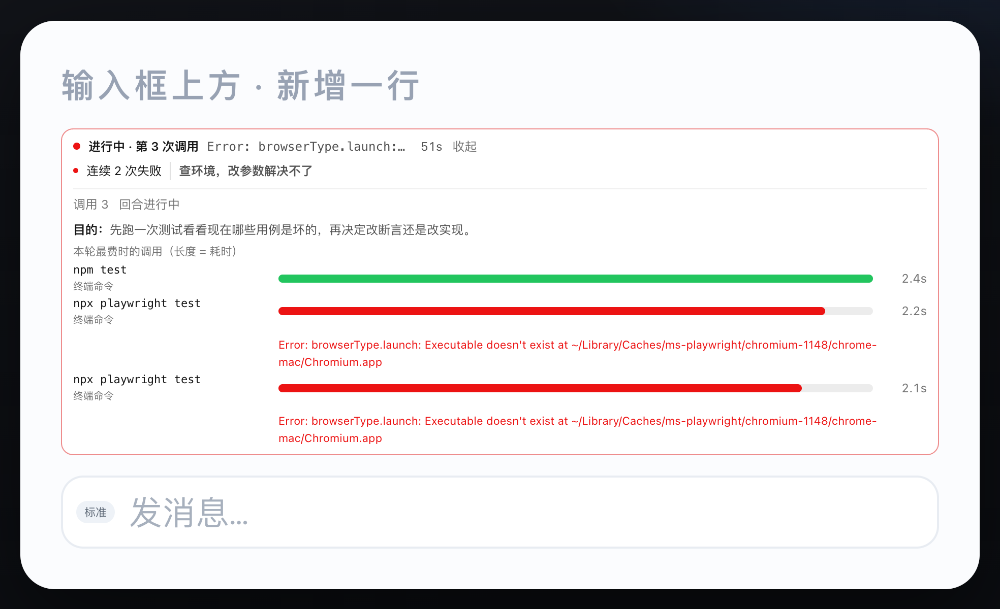
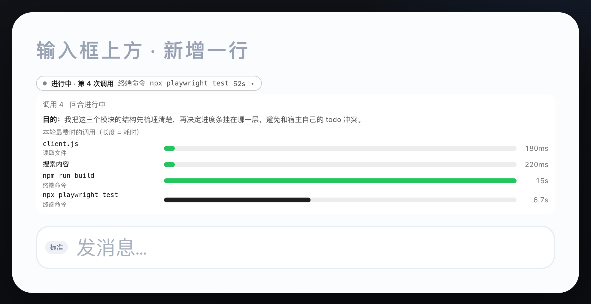

# dsh-tool-progress · 工具调用哨兵

> **它不显示历史，只提醒你现在该不该管。**
>
> 上下文花在哪，看 [dsh-context](https://github.com/bowenliang123/dsh-context)；
> 此刻卡在哪，看这个。

DeepSeek Harness 的 Web UI 插件。平时安静，有事才开口。




> 动图录制的是真实组件代码（同一份 `client.js`），数据用模拟快照驱动，几秒内展示全部状态。
> GIF 没加载出来时，上面的静态图就是它平时的样子。

**安装** → [INSTALL.md](INSTALL.md)。需要先有 DeepSeek Harness。

---

## 它会在这些时刻主动开口

<table>
<tr><th>什么时候</th><th>它说什么</th><th>你该做什么</th></tr>
<tr>
<td>参数生成超过 <b>8 秒</b>还没派发</td>
<td>「模型在生成长参数，不是工具卡了」</td>
<td><b>继续等</b>。这是最容易误判成死机的场景</td>
</tr>
<tr>
<td>连续 <b>≥3 次</b>调用同一工具同一目标</td>
<td>「连续 4 次 终端命令 同一目标」</td>
<td><b>考虑打断</b>，换个说法重来</td>
</tr>
<tr>
<td>连续 <b>≥2 次</b>失败</td>
<td>「连续 3 次失败」+ 失败原因</td>
<td><b>查环境</b>，不是改参数能解决的</td>
</tr>
<tr>
<td>慢于本回合同工具中位数的 <b>3 倍</b></td>
<td>「比平时久约 5 倍」</td>
<td><b>看一眼</b>是不是命令本身变重了</td>
</tr>
</table>

这四条都有前提门槛（见下方「异常检测」），**宁可漏报，不狼来了**。

### 四个状态长什么样

| 进行中 | 已完成 |
| --- | --- |
|  |  |

| 连续失败（自动升级为告警卡） |
| --- |
|  |

| 展开：本轮最费时的调用（长度 = 耗时） |
| --- |
|  |

---

## 你的疑问 → 它给什么

| 你的疑问 | 这一行给的答案 |
|---|---|
| **它是不是死了？** | 参数生成超过 8 秒会明说「在生成，不是卡住」——不用再猜 |
| **这条命令要跑多久了？** | 当前调用实时走秒 + 本回合总用时 |
| **刚才那步为什么失败？** | 直接给 `error` 原文，拿不到就只写「失败」，**不猜** |
| **这一轮到底做完没有？** | 回合级状态（进行中/已完成/失败），不是最后一次调用的状态 |
| **时间花在哪了？** | 展开看本轮最费时的 8 次调用（长度 = 耗时） |

---

## 和上下文统计类插件的区别

这两件事经常被混淆，但时间维度相反：

| | 上下文统计（如 dsh-context） | 本插件 |
| --- | --- | --- |
| 回答 | 「已经发生的」上下文怎么组成的 | 「**正在发生的**」这一步在做什么 |
| 时间 | 历史、趋势、7 天统计 | **此刻** |
| 使用方式 | 你主动打开一个页面看 | 它主动找你，只在出事时 |
| 关注 | token、成本、压缩、多 Agent | 卡住、耗时、失败原因 |

**不冲突，装了两个都用得上。** 仪表盘告诉你昨天花了多少，哨兵告诉你现在要不要管。

---

## 核心取舍：大部分时间应该安静

v1 每回合占着一整块 70px 卡片。问题不是信息不够，是**太吵**——85% 的时间用户什么都不用管。

v2 的默认态是一枚约 **25px** 的细胶囊，只有检测到异常才升到整块卡片。

## 胶囊说的是「回合」，不是「最后一次调用」

这一条是踩过坑才定的。早期版本的主标题取「最后一次工具调用」的状态，于是：

> 一次工具跑完、模型还在思考下一步时，胶囊显示「已完成」——
> 而整个回合其实还在跑（实测在回合进行到 22 秒时显示"已完成"）。

现在的主标题一律描述**回合本身**，单次调用降为副标题：

| 回合状态 | 判断依据 | 主标题 | 圆点 |
| --- | --- | --- | --- |
| **进行中** | 有 turn 但无 `turn/end` | `进行中 · 第 12 次调用` | 呼吸点 |
| **已完成** | 存在 `turn/end` | `已完成 · 12 次调用` | 绿 |
| **失败** | 本回合有 `isError` | `失败` + 具体原因 | 红 |

副标题给当前这次调用在做什么（`终端命令 npm run build · 12s`）。
右侧的时长是**回合总用时**，不是单次调用耗时。

**不设超时兜底**：回合没 emit `turn/end` 就一直显示「进行中」。
宁可收尾慢一点，也不去猜「疑似已停止」——猜错比不猜更误导。

---

## 异常检测：只在有依据时说话

| 告警 | 触发条件 | 为什么要报 |
| --- | --- | --- |
| **生成参数偏久** | `preparing` 阶段超过 8 秒 | 用户最容易误判成「工具卡死」的场景——其实是模型在生成长参数 |
| **原地打转** | 尾部连续 ≥3 次同工具 + 同目标 | 模型在反复试同一件事 |
| **连续失败** | 尾部 ≥2 次失败 | 大概率是工具链问题，不是这一次参数的问题 |
| **比平时久** | 慢于本回合同工具中位数的 3 倍，且基准 ≥1s、本次 ≥3s、样本 ≥3 | 需要「久不久」的判断，不是原始数字 |

### 「比平时久」踩过的坑

初版拿纯中位数比：一轮里前几次 bash 都是 20ms 的 `ls`，接着启动一次浏览器花了 10s ——
结果报「**慢 175 倍**」。那不是异常，是两种完全不同的活。

现在的门槛：基准 < 1s 不比、本次 < 3s 不提、样本 < 3 不比、比值封顶报到 9 倍。
**宁可漏报，也不狼来了。**

---

## 诚实边界

- **不编造百分比。** 「已完成 138/139」说的是"调用次数"，不是"活干完了多少"，标成百分比会被误读。
- **失败必须给原因，且只给真实原因。** 取值优先级：`root.error`（字符串或 `.message`）→ `root.content` 末段文本 → 都没有就只写「失败」，**不猜**。
- **不猜剩余时间。** 没有足够同类历史时，「预计还需 30 秒」就是编数字。
- **没有工具调用时不画空进度条**，只显示「正在思考」。
- **不额外发请求。** 数据全部来自 Chat 快照里已投影好的节点，不新建事件源、不轮询 Host。
- **失败不外溢。** 读快照整段 try/catch：别的包改了节点形状，这一行自己隐身，绝不把异常抛进槽位把输入区拖崩。
- **闲时不空转。** 只在「真在跑」或「刚结束 10 分钟内」开 500ms 计时器；打开几小时前的老会话不会每半秒重渲染。
- **告警只弹一次。** 手动收起后同一类告警不再弹回来（签名用 code，不用带倍率的文本——否则倍率一变就又弹）。

---

## 轻量

| | 本插件 |
| --- | --- |
| 依赖 | **零** —— `dependencies` 与 `peerDependencies` 都为空 |
| 构建 | **无** —— 单文件 `client.js`，改完刷新即生效 |
| 体积 | 42 KB 源码，无 dist 产物 |

---

## 数据来源（全部来自 Chat 快照）

| 字段 | 用途 |
| --- | --- |
| `snapshot.order` / `snapshot.nodes` | 渲染顺序与节点表 |
| `tool-call` 的 `data.root.phase` | `preparing` = 参数还在流 |
| `root.kind === 'tool-result'` | 已收尾；`isError` / `error` / `content` 给失败原因 |
| `root.time` / `root.callTime` | 结束 / 开始时间，相减即耗时 |
| `node.location.turn` | 回合号、状态、起止时间；**有无 `turn.end` 决定「进行中 / 已完成」** |
| `assistant-step` 的 reasoning block | 「目的」那句话（取最后一句完整的，不是半句碎片） |
| `root.subCalls` | 嵌套子调用数 |

---

## 主题适配

颜色全部走主题变量。踩过两个坑：
- `--dsw-alias-brand-primary` 在这个主题里是近黑 `#0f1115`，不是强调色，当"运行中"用会读成灰 → 改用 `label-primary`
- `--dsw-alias-bg-layer-2` 和 `bg-layer-1` 都是纯白，拿来画轨道看不见 → 改用 `label-primary` 8% 透明度叠出来的浅底

---

## 文件

```
tool-progress/
├── package.json       # dsh.bundle.patch + dsh.client
├── cordis.patch.yml
├── index.js           # Host 半端：注册即空
├── client.js          # 全部逻辑与样式（单文件，无构建）
├── locale/{zh,en}.json
├── icon.svg
├── INSTALL.md         # 安装步骤与排障
└── docs/              # hero.png / demo.gif / demo.webm / state-*.png
```

---

## 自检修掉的缺陷（留档）

这些都是实际发生过的错误，不是假想：

| 症状 | 根因 |
| --- | --- |
| 绿点旁边写「失败」 | 圆点看「最后一次调用」、标题扫「整个回合」，两套判据。已统一看回合 |
| 一次成功调用被标失败 | `turnId === undefined` 的节点被无条件放行，旧回合的失败混进了当前回合。已改为排除 |
| 展开面板打不开 | 渲染条件用 `open`，状态变量却是 `expanded`。已统一 |
| 当前调用指向旧记录 | 取数组尾而不是最大 `anchorSeq`。已改 |
| 界面中文却显示 "Thinking" | 用 `navigator.language` 猜语言，而 Electron 以 `--lang=en-US` 启动。已改为读宿主 locale |

---

## 已知未做

- 单次长命令**内部**的进展（`npm install` 装到第几个包）——Runtime 只记调用开始与结果两条事件
- 「我该干什么」的**动作按钮**（重试/跳过/打断）——目前只给文字建议，不直接执行
- 「目的」仍是启发式猜测；真解是让模型调工具时自己写意图，属于工具契约层面
- 回合异常终止但没 emit `turn/end` 时，会一直显示「进行中」——这是有意为之，不做超时推测
